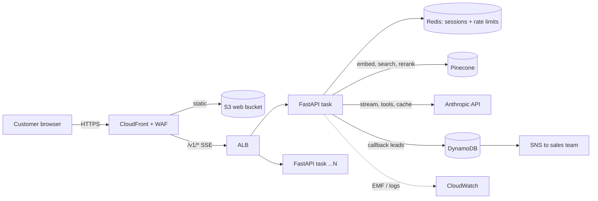

<div align="center">

# ✨ ZenShine Assistant

**A production-grade AI customer assistant platform — grounded answers, accurate pricing, and qualified leads, out of the box.**

[](LICENSE)
[](backend)
[](backend)
[](frontend)
[](frontend)
[](https://www.anthropic.com)
[](infrastructure)

</div>

---

## What this is

ZenShine Assistant is a **multi-tenant, multilingual AI assistant for customer-facing businesses** — the kind of chatbot a company would actually put in front of paying customers, not a weekend demo.

It answers customer questions using **Claude**, grounded strictly in that business's own knowledge base (so it doesn't make things up), quotes **accurate prices** with a deterministic pricing engine (so the model never does arithmetic on money), captures **qualified leads** for the sales team, and streams every reply live to a clean React chat widget.

It is built the way a real SaaS product is built: typed and tested end to end, deployed on AWS with Terraform, scanned and shipped through CI/CD, observable in production, and hardened against prompt injection and abuse — not a prototype dressed up for a pitch deck.

> Originally replaced an earlier Streamlit + Groq + Qdrant prototype with something that could survive real customer traffic.



## Why it matters

| For a business | What ZenShine does about it |
|---|---|
| Customers ask the same questions all day | Claude answers instantly, grounded in the company's own FAQ/knowledge base — no hallucinated policies |
| Pricing mistakes cost money and trust | A deterministic quote engine computes prices; the LLM never touches arithmetic |
| Leads get lost in chat transcripts | Every interested visitor is captured as a structured lead and pushed straight to the sales team |
| One bot, many brands/markets | Each market is just a YAML config + a knowledge folder — no code changes to launch a new one |
| "Will this survive launch day?" | Autoscaling, rate limiting, circuit breakers, and a full AWS deployment already wired up |

## Quickstart (about 3 minutes)

You need Docker and two keys: an [Anthropic API key](https://console.anthropic.com) and a [Pinecone API key](https://app.pinecone.io).

```bash
git clone https://github.com/manobhisriram/Zenshine-Assistant.git
cd Zenshine-Assistant
cp .env.example .env            # then fill in ANTHROPIC_API_KEY and PINECONE_API_KEY
docker compose up --build
```

Open <http://localhost:8080>. On first start the API creates the Pinecone serverless index and embeds the knowledge base (`backend/knowledge/zenshine/faq.pdf`); this takes under a minute and is idempotent afterwards.

Without Docker: `make install && make dev` (API on :8000, UI on :5173).

## What's in the box

| Capability | How |
|---|---|
| Grounded answers | Pinecone hosted `multilingual-e5-large` embeddings + `bge-reranker-v2-m3` reranking, per-tenant namespaces, score thresholds, retrieved text treated as untrusted data |
| Claude agent | Anthropic Messages API streaming, tool-use loop, prompt caching on the static system block, automatic fallback model, circuit breaker |
| Correct prices | `calculate_quote` tool backed by a deterministic engine driven by `tenants/*.yaml`; the model never does price arithmetic |
| Leads | `request_callback` tool: consent + phone validation, stored in DynamoDB (TTL-expired) and alerted over SNS |
| Many markets | A market is one YAML file (services, prices, currency, locale, UI copy) plus a `knowledge/<tenant>/` folder; see [docs/ADD-A-MARKET.md](docs/ADD-A-MARKET.md) |
| Scale | Stateless tasks, Redis-backed sessions and rate limits, autoscaling on CPU and requests/target, SSE through CloudFront and ALB |
| Security | WAF (managed rules + per-IP rate limits), origin lock to CloudFront, least-privilege IAM, secrets in Secrets Manager, PII-masked logs, prompt-injection defences, strict headers; see [SECURITY.md](SECURITY.md) |
| Observability | Structured JSON logs, CloudWatch EMF metrics (TTFT, tokens, cache hits, fallbacks), Prometheus `/metrics`, OpenTelemetry traces, dashboard and alarms |
| Delivery | GitHub Actions CI (lint, types, tests, build, image scan), keyless OIDC deploy to AWS with rollback, weekly security scans |

## Repository layout

```
backend/            FastAPI service (app/), tenants/, knowledge/, tests/, Dockerfile
frontend/           React + Vite + TypeScript chat UI (SSE streaming), vitest
infrastructure/     Terraform for the whole AWS stack + first-deploy script
.github/workflows/  ci.yml, deploy.yml, security.yml
docs/               Architecture, deployment, operations, API, ADRs
tests/load/         k6 load test
```

## Deploy to AWS

Short version (full guide in [docs/DEPLOYMENT.md](docs/DEPLOYMENT.md)):

```bash
cd infrastructure/terraform/bootstrap && terraform init && terraform apply     # remote state bucket, once
cd ../../.. && cp infrastructure/terraform/environments/prod.backend.hcl.example infrastructure/terraform/environments/prod.backend.hcl  # edit bucket name
./infrastructure/scripts/first-deploy.sh prod                                  # ECR, image, full stack
# then put the two API keys into Secrets Manager (the script prints the exact commands)
```

After that, every merge to `main` builds, scans and deploys through GitHub Actions with no stored AWS credentials.

## Configuration

Everything is environment-driven (`backend/app/config.py`; `.env.example` lists the common ones).

| Variable | Purpose |
|---|---|
| `ANTHROPIC_API_KEY` | Anthropic API key (required) |
| `PINECONE_API_KEY` | Pinecone API key (required) |
| `ANTHROPIC_MODEL` / `ANTHROPIC_FALLBACK_MODEL` | Primary and fallback models |
| `PINECONE_INDEX` / `_CLOUD` / `_REGION` | Index name and serverless placement |
| `REDIS_URL` | Shared sessions and rate limits (required when running more than one instance) |
| `ADMIN_API_KEY` | Protects `/v1/admin/*` (24+ chars; required in production) |
| `DEFAULT_TENANT`, `CORS_ORIGINS`, `TRUSTED_PROXY_HOPS` | Tenant selection, allowed origins, client-IP resolution |

## Quality gates

`make lint test` runs ruff, mypy, 39 backend tests (including the real Anthropic SDK against a mocked wire stream, DynamoDB via moto, Redis via fakeredis) and the frontend typecheck and tests. CI runs the same plus a container smoke test and image scan.

## Documentation

- [Architecture](docs/ARCHITECTURE.md)
- [AWS deployment](docs/DEPLOYMENT.md)
- [Operations runbook](docs/OPERATIONS.md)
- [API reference](docs/API.md)
- [Add a market or brand](docs/ADD-A-MARKET.md)
- [Design decisions](docs/DECISIONS.md)
- [Security policy](SECURITY.md)

## License

MIT — see [LICENSE](LICENSE).
