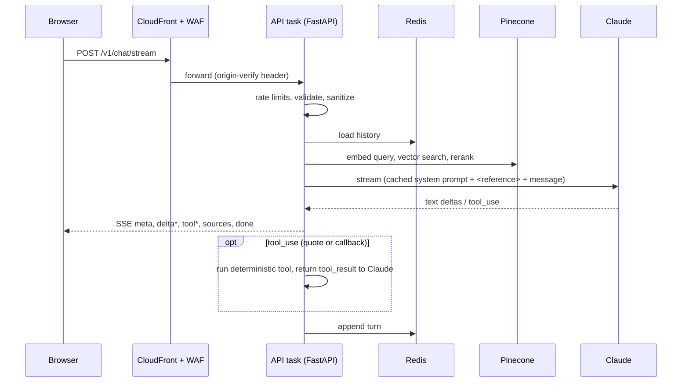

# Architecture

## Request flow (one chat turn)

Events on the stream: `meta` (session and message ids), `delta` (text), `tool` (status), `sources`, `done` (model, tools, latency) or `error`. `POST /v1/chat` returns the same turn as one JSON body.

## Components

| Component | Responsibility | Code |
|---|---|---|
| API | HTTP, SSE, validation, rate limiting, admin | `backend/app/api/` |
| Agent | Claude streaming, tool loop, fallback model, circuit breaker, usage metrics | `app/services/agent.py` |
| Retrieval | Embed, search, rerank, threshold, degrade gracefully | `app/services/rag.py`, `vectorstore.py` |
| Ingestion | Parse PDF/MD/TXT into passages, idempotent sync, stale cleanup | `app/services/ingest.py` |
| Quote engine | Deterministic pricing and discounts from tenant config | `app/services/pricing.py` |
| Tools | `calculate_quote`, `request_callback` with validation | `app/services/tools.py` |
| Tenants | Brand, locale, currency, services, discounts, UI copy | `tenants/*.yaml`, `services/tenants.py` |
| Prompt | Tenant-derived static block (cacheable) + per-turn reference block | `app/prompts/system.py` |
| Core | Settings, logging with PII masking, errors, security middleware, metrics, tracing | `app/core/` |

## Design for scale and latency

- **Stateless tasks.** All shared state is in Redis (sessions, rate-limit counters) or Pinecone. Scale-out is adding tasks; there is no sticky routing.
- **Time to first token.** Retrieval is one embed call, one query and one rerank (reranking is optional and degrades silently). The static system prompt is cached (Anthropic prompt caching), so repeated turns pay mainly for the reference block and history. Streaming starts as soon as Claude emits text.
- **Backpressure.** Pinecone calls run in worker threads behind a bounded `CapacityLimiter`; Anthropic calls use the async client with timeouts and bounded retries.
- **Failure isolation.** Vector store down: the bot still answers and says it lacks context. Primary model overloaded: automatic fallback to the smaller model, and a circuit breaker routes straight to the fallback for 30 s after repeated failures. Redis down: rate limiting fails open (with error logs and alarms) and history is skipped rather than failing the turn. SNS down: the lead is still stored.
- **Autoscaling.** Target tracking on CPU and ALB requests per target; deployments use a circuit breaker with automatic rollback.
- **SSE through the edge.** CloudFront caching disabled on `/v1/*`, ALB idle timeout 120 s, response buffering off in the local nginx, `X-Accel-Buffering: no`.

## Multi-tenancy and markets

Tenant id selects the YAML definition and the Pinecone namespace, so data never mixes. Currency formatting, supported languages and UI copy come from the tenant file; Claude replies in the customer's language. To serve a new country, add a tenant file and knowledge folder (see [ADD-A-MARKET.md](ADD-A-MARKET.md)). For regional latency or data residency, deploy another regional stack (`name_suffix`, `region`) and route with Route 53 latency or geolocation records.

## Data stores

| Store | Contents | Retention |
|---|---|---|
| Pinecone (namespace per tenant) | FAQ passages and embeddings | Until re-ingested |
| Redis | Conversation turns (last `HISTORY_TURNS`), rate-limit counters | `SESSION_TTL_SECONDS` (default 6 h) |
| DynamoDB | Callback leads | `LEADS_RETENTION_DAYS` (default 90) via TTL |
| CloudWatch Logs | Structured logs (PII masked, no message bodies) | `log_retention_days` |
